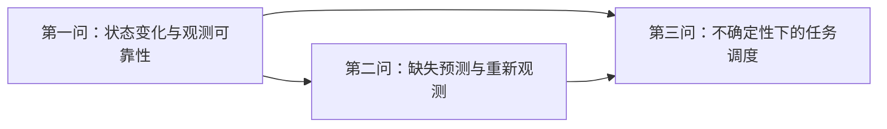

# C题三个问题之间的关联与模型衔接

## 1. 总体关系

三问构成“认识状态→管理观测→安排作业”的递进关系，不是将同一预测模型连续调用三次。各问可以分别优化，但最终必须统一状态含义、数据划分与信息访问边界。

|问题|核心任务|向后提供的成果|
|---|---|---|
|第一问|定义状态，研究运动变化、观测质量及任务/环境/阶段差异|状态表示、动态模型、可靠性证据与失败边界|
|第二问|无新观测时预测状态，更新不确定性，决定请求与等待|预测可持续时长、观测成本—误差权衡、信息更新机制|
|第三问|在预算、截止时间和前驱约束下安排任务、预留时长与复核|综合决策结果，验证信息是否真正改善作业安排|

## 2. 第一问与第二问：直接共享状态表示

题目要求第二问沿用第一问选定的状态变量。当前第一问使用每只手21个三维关键点的几何中心，第二问应继续预测这一状态，不能在未解释的情况下改成商品位置、完整手姿态或其他目标。

第一问建立动态模型，并验证其对合格留出记录的预测一致性。第二问在此基础上人工隐藏部分时间或通道，研究误差如何随缺失时长增长、预测范围能否覆盖参考状态，以及何时值得请求再次观测。

当前旋转模型可作为第二问的点预测候选，但不能直接将已有轨迹误差当作完整第二问结果。仍需对最终模型重新建立或核验：

1. 各缺失时长下的误差与不确定性更新。
2. 名义覆盖率、实际覆盖率和范围大小。
3. 请求时机、预算、返回延迟与等待安排。
4. 信息返回后的状态更新和后续决策。
5. 自然低质量事件与人工遮罩的差异。

第一问的“未来源标坏概率”不等于“未来定位误差超过容差的概率”。再次观测只能返回原记录实际存在的信息，且必须等到延迟结束后才能使用；发起请求不会将低质量记录变成准确真值。

## 3. 第一问与第三问：提供特征与规律，不能替代时长模型

第三问需要根据当前可见的作业前缀，估计服务时长及其不确定性。第一问中的运动速度、双手关系、历史变化和阶段差异可以成为时长模型的候选输入。

但手部位置预测与任务时长预测具有不同监督目标。轨迹预测更准确，并不必然使时长估计更准确；更准确的时长估计，也未必改变调度顺序或提高按时率。因此第三问仍需独立比较任务族统计、前缀模型等时长方案，并验证新增特征是否产生实际调度收益。

手部状态只是人工操作代理，不应直接解释为商品状态、商品数量或机器人的实际作业性能。

## 4. 第二问与第三问：共享信息决策思想，使用不同协议

两问都涉及信息成本、返回延迟、等待与信息更新，但不能混用实验规则。

|项目|第二问|第三问|
|---|---|---|
|信息对象|遮罩后暂不可见的状态通道|指定源作业区间逐级披露的数值前缀|
|信息动作|请求原记录中实际存在的观测|按规定将累计可见前缀从0.2秒扩至0.6秒，再扩至1秒|
|成本与延迟|事先明确并对所有方法统一|每次复核消耗1个情景秒和1个成本单位|
|等待意义|不请求或等待已请求信息返回，期间可继续预测|等待不增加已披露前缀|
|主要收益|减少状态误差或控制不确定性|改善任务选择、顺序、服务预留及最终调度指标|

第三问的0.2/0.6/1秒表示累计可见的原始前缀长度；第一、二问中相同数值常表示未来预测时长。数字相同，时间语义不同，不能混淆。

第三问可借鉴第二问的信息价值思想：只有新增信息可能改变决策，且收益能够抵偿时间和成本时，复核才有价值。具体策略仍需按第三问固定协议单独验证。

## 5. 三问的评价不能互相代替

|问题|需要评价的内容|不能据此直接声称|
|---|---|---|
|第一问|状态误差、一致性、质量模型表现、不确定性及失败案例|真实商品定位精度或机器人成功率|
|第二问|预测误差、覆盖率与范围大小、请求次数/成本、等待和计算开销|只靠扩大预测范围获得有效改进|
|第三问|完成率、加权按时率、拖期、成本、设备占用、超预留与闲置等共同指标|时长误差下降就等于按时率提升|

当前第一问主方案开发集轨迹误差相对同口径基线降低约4.15%。这不意味着第二问观测成本降低4.15%，也不意味着第三问按时率提高4.15%。收益必须通过对应的遮罩回放和调度实验分别验证。该开发结果属于历史反复使用开发集的探索性证据，最终测试尚未开展。

## 6. 统一接口与信息边界

|接口|建议输出|约束|
|---|---|---|
|第一问→第二问|状态定义、预测函数、历史输入规范、质量标记及失败条件|沿用同一状态；所有在线输入不晚于当前时刻|
|第一问→第三问|合法前缀特征、运动与阶段规律、质量/缺失处理规则|不读取区间结束时刻、未来状态或未披露标识|
|第二问→第三问|信息价值评估、延迟更新和等待的处理方法|按第三问规则重建动作与成本，不照搬第二问协议|
|最终评价|冻结模型、阈值、偏好、统一划分及逐试验记录|测试前冻结；不随机拆分相关帧后宣称独立泛化|

三问应使用附件指定的环境划分。训练用于拟合，开发用于选择，测试用于冻结后最终评价。跨来源同环境需要一起处理，不能把来源内环境数相加当作独立环境数。

## 7. 当前项目的衔接建议

1. 保留第一问旋转模型作为当前状态预测主方案候选，不把它称为全局最优。
2. 第二问围绕该最终中心模型重新对齐残差、风险尺度与预测范围，比较不请求、固定请求及自适应请求等统一协议策略。
3. 第三问独立建立时长分布模型，先验证第一问特征是否优于任务族统计，再判断付费前缀是否足以改善决策。
4. 通过消融分别检验状态模型、信息获取和任务排序的贡献，避免将整个系统的收益全部归因于某一个模型。
5. 允许各问采用不同的具体算法；最终交付需形成一致、可追溯的因果信息链，而不是强行使用统一算法。

本文件为问题关联与衔接说明，不代表第二问、第三问已完成，也不恢复已暂停的优化目标。
