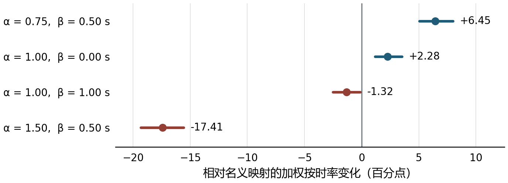

## 敏感性分析

在模型参数和决策规则固定的条件下，分别改变轨迹预测的可见历史长度、付费观测的回传延迟和调度任务的服务时长。前两问在相同的 212 个开发窗口上逐窗配对，另列原有 390 个测试窗口的结果。第三问沿用三个官方案例、每例 30 个验证种子。轨迹预测用归一化平均位移误差（NADE）衡量，数值越小表示预测越准。调度用加权按时率衡量，先计算按时完成的任务权重占比，再对三个案例等权平均。

### 可见历史长度对质心预测的影响

固定预测起点及其后的真实轨迹，同时截短头部和双手在起点前的可见记录。完整历史使用起点前全部可用观测，模型最远提取约 2 秒的运动特征。截短历史时，沿用模型已有的缺失特征处理规则和误差球半径。表中各时长的 NADE 均在起点至该时长的整个区间内计算。

**不同可见历史长度下的质心预测结果（开发集）**

| 可见历史 | 0.2 秒 NADE | 0.6 秒 NADE | 1.0 秒 NADE | 1.0 秒逐点覆盖率 |
|---|---:|---:|---:|---:|
| 完整历史 | 0.03320 | 0.11092 | 0.18427 | 84.06% |
| 最近 0.75 秒 | 0.03260 | 0.10969 | 0.18547 | 83.72% |
| 最近 0.30 秒 | 0.03394 | 0.11289 | 0.18905 | 83.38% |

在 1 秒预测区间内，将历史截至 0.30 秒，NADE 较完整历史上升 2.59%，球内覆盖率下降 0.68 个百分点。在 0.2 秒和 0.6 秒预测区间，保留 0.75 秒历史时的误差略低于使用完整历史时的误差。历史长度的影响随预测时长变化。固定完整历史后，测试集在三个预测区间的 NADE 分别为 0.02925、0.11022 和 0.19660，表明预测距离起点越远，累积区间的平均误差越大。

### 回传延迟与观测预算对遮挡预测的影响

将遮挡时长固定为 1 秒，在遮挡开始后 0.3 秒和 0.6 秒各请求一次观测。仅改变单次回传延迟，保留首次有效回传前、后各自的误差球参数。三个延迟设置下，每个窗口均收到两次有效回传。

**相同请求预算下的回传延迟实验（开发集）**

| 单次延迟（秒） | 累计等待（秒） | NADE | 平均归一化球直径 | 逐点覆盖率 |
|---:|---:|---:|---:|---:|
| 0.00 | 0.00 | 0.06157 | 0.22465 | 85.29% |
| 0.10（名义） | 0.20 | 0.08874 | 0.32574 | 87.20% |
| 0.20 | 0.40 | 0.11141 | 0.41884 | 87.03% |

单次延迟由 0.10 秒增至 0.20 秒，NADE 上升 25.54%，球直径增大 28.58%。覆盖率仅下降 0.17 个百分点，但维持相近覆盖所需的空间范围更大。三档延迟的归一化末帧误差均为 0.14953，因为第二次回传均已在末帧前到达，届时模型使用相同的两个采样位置更新速度。延迟主要影响等待回传期间的预测。

遮挡较短时，回传的作用也随之改变。开发集遮挡 0.2 秒时，窗口在首次计划请求前结束，三档延迟下的 NADE 均为 0.03958。另在 390 个测试窗口上固定遮挡 1 秒、延迟 0.10 秒，把请求预算从 0 次依次增至 1 次、2 次，NADE 由 0.20377 降至 0.14054、0.09354。两次新增请求分别降低误差 0.06323 和 0.04700，各增加 0.10 秒等待。

### 服务时长映射对调度按时率的影响

设任务的来源时长为 d，将服务时长写作 p = αd + β，其中 α 为比例系数，β 为固定附加时长（秒）。固定每步前瞻的联合场景数 K = 64、任务表及调度规则，逐次改变 α 或 β。五种映射使用相同的案例和验证种子，共计 450 次回放。所有回放均满足协议，非法动作数为零。

**不同服务时长映射下的加权按时率（官方验证）**

| α | β（秒） | S1 | S2 | S3 | 三案例均值 |
|---:|---:|---:|---:|---:|---:|
| 0.75 | 0.50 | 100.00% | 96.39% | 95.83% | 97.41% |
| 1.00 | 0.00 | 99.58% | 92.22% | 87.92% | 93.24% |
| 1.00 | 0.50（名义） | 98.75% | 89.44% | 84.69% | 90.96% |
| 1.00 | 1.00 | 98.54% | 88.19% | 82.19% | 89.64% |
| 1.50 | 0.50 | 85.63% | 69.31% | 65.73% | 73.55% |

固定 β = 0.50 秒，把 α 从 1.00 提至 1.50，三案例平均按时率下降 17.41 个百分点。其中 S3 由 84.69% 降至 65.73%。同一扰动下，平均加权完成率由 95.28% 降至 80.87%，表明工期拉长还会压缩可完成的任务量。固定 α = 1.00，仅将 β 从 0.50 秒增至 1.00 秒，平均按时率下降 1.32 个百分点。五种映射的总平均为 88.96%，这一均值掩盖了长工期下的按时率损失。

**工期扰动相对名义映射的加权按时率变化。** 点表示三案例等权的配对差，横线表示 95% 自助法百分位区间。每次按种子成组重抽，保留同一种子下的三个案例及全部映射，共重抽 10 000 次。α = 1.50、β = 0.50 秒时，按时率降幅的区间为 15.56 至 19.31 个百分点。区间描述这三个案例中由种子抽样带来的不确定性，向新作业环境推广仍需单独验证。
